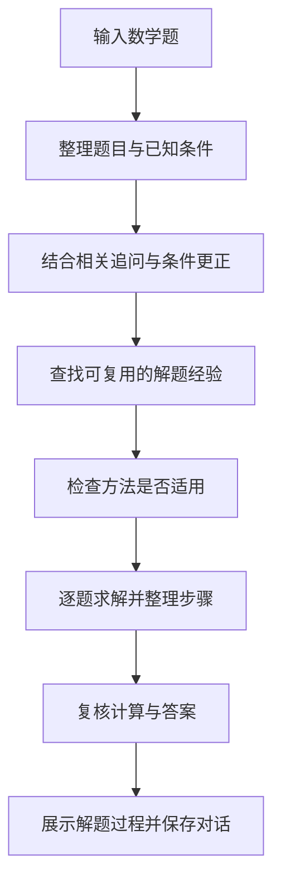
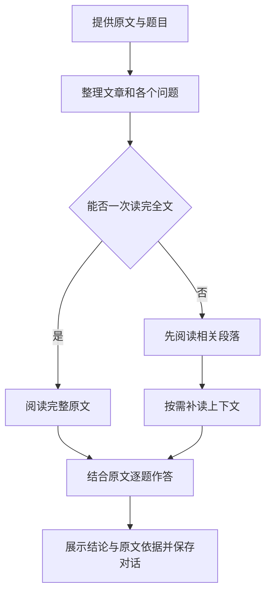

# 松间学习助手

支持语文阅读、数学解题和英语练习。

## 解题流程

### 数学



### 语文



## 启动后端

准备 Node.js 24.12+、已启动的 PostgreSQL 数据库和可用的模型服务 API Key。将下方数据库用户名、数据库名替换为自己的配置。

在项目根目录打开 PowerShell：

```powershell
cd backend
npm ci
if (-not (Test-Path -LiteralPath .env)) {
    Copy-Item -LiteralPath .env.example -Destination .env
}

$env:PGHOST = 'localhost'
$env:PGPORT = '5432'
$env:PGUSER = 'postgres'
$env:PGDATABASE = '你的数据库名'
$dbPassword = Read-Host '数据库密码' -AsSecureString
$env:PGPASSWORD = ([System.Net.NetworkCredential]::new('', $dbPassword)).Password

$apiKey = Read-Host '模型服务 API Key' -AsSecureString
$env:LLM_API_KEY = ([System.Net.NetworkCredential]::new('', $apiKey)).Password
$env:PORT = '8080'
$env:FRONTEND_ORIGIN = 'http://localhost:5173'

npm run dev
```

启动成功后，保持此终端运行。

## 打开前端

在项目根目录另开一个 PowerShell 终端：

```powershell
cd frontend
npm ci
$env:VITE_PORT = '5173'
$env:VITE_CHAT_MODE = 'backend'
npm run dev
```

打开 [http://localhost:5173](http://localhost:5173)，注册或登录后选择学科，即可输入题目开始练习。阅读题请附上原文，选择题请保留选项。
