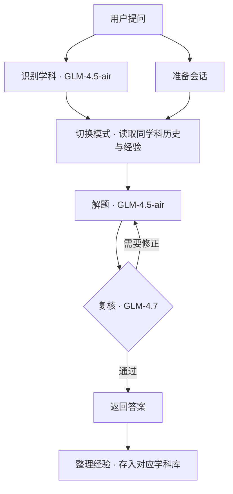

# 松间学习助手

支持语文、数学、英语，自动识别学科并切换学习模式。



## 启动

准备 Node.js 24.12+、已启动的 PostgreSQL（数据库 `agentest`）和智谱 API Key。

**后端：** 在 PowerShell 执行，`npm ci` 仅首次需要。

```powershell
npm ci
$env:PGUSER = 'postgres'
$env:PGDATABASE = 'agentest'
$env:PGPASSWORD = Read-Host '数据库密码'
$env:LLM_API_KEY = Read-Host '智谱 API Key'
$env:FRONTEND_ORIGIN = 'http://localhost:3000'
npm run dev
```

**前端：** 另开一个 PowerShell 终端。

```powershell
npm ci
$env:VITE_PORT = '3000'
$env:VITE_AUTH_ENABLED = 'true'
$env:VITE_CHAT_MODE = 'backend'
$env:API_PROXY_TARGET = 'http://localhost:8080'
npm run dev
```

打开 [http://localhost:3000](http://localhost:3000)，使用已有账号登录。两个终端保持运行。