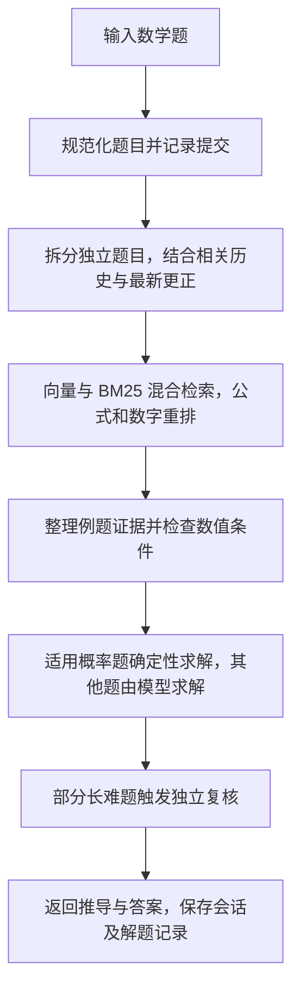
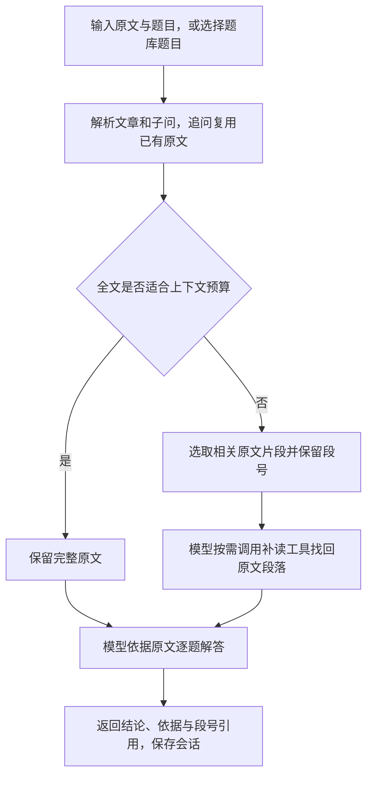

# 数学与语文解题助手

基于 Agent + Harness 的初三学习助手，支持数学检索解题和语文阅读理解，前端使用 Vue，后端使用 TypeScript。

## 依赖

- 运行环境：Node.js 24.12+（24.x）、npm、PowerShell 7。
- 后端：Express 5、LangChain、MCP SDK、AJV、js-tiktoken。
- 前端：Vue 3、Vite、KaTeX。
- 模型服务：主解题使用 GLM-4.5-Air，独立核验使用 GLM-4.7；数学检索使用 GLM embedding-3。

npm 依赖通过下面的 `npm ci` 安装；模型服务需要可用的 API Key。

## 子 agent 与答案核验

基础 `AgentRuntime` 提供 `agents` 和 `delegate({ agent, input, context? })`，通过 `HarnessOptions.subAgents` 注册有名字的子 agent。每个定义指定模型、工作流、指令和工具；父任务的历史、工具和权限不会自动传给子任务。子 agent 默认不能继续委派，需在定义的 `delegates` 中明确授权。

新增其他多智能体场景时，注册新的定义并在工作流中调用即可：

```ts
const subAgents = [{
    name: "researcher", description: "核对指定材料", model: researchModel,
    workflow: new SingleTurnAgent(), tools: [],
    instructions: { system: "依据提供的材料核对事实。", final: "返回核对结果。" },
}];
// 将 subAgents 传给 AgentHarness 的 options；工作流通过 runtime 委派。
const result = await runtime.delegate({ agent: "researcher", input: material });
```

`HarnessOptions.delegation` 控制整轮共享的调用次数、嵌套深度、同时运行数量、单次超时和输出长度。子任务仍经过基础 harness 的上下文预算、工具策略、恢复和取消机制；子任务默认不继承父任务的备用模型或结果处理器。追踪通过 `agent.subagent.*` 事件关联任务，调用统计包含子任务。

`HarnessOptions.resultProcessors` 是工作流返回后的通用处理阶段。数学和语文使用 `AnswerReview`：主模型生成候选答案 → GLM-4.7 独立返回结构化核验报告 → 发现确定错误时由主模型修正 → 再核验修正版。程序直接计算得到的答案也经过该阶段。语文核验使用完整原文和实际问题，不读取题库参考答案；数学核验保留用户条件更正及支持的程序计算结果。

`ANSWER_REVIEW_ENABLED` 控制启用；GLM 开发/生产配置默认启用，测试和旧通用模型配置默认关闭。`ANSWER_REVIEW_MODEL` 默认为 `glm-4.7`，`ANSWER_REVIEW_TIMEOUT_MS` 默认为 120000，`ANSWER_REVIEW_MAX_REVISIONS` 默认为 1。同一地址复用 `LLM_API_KEY`；不同地址必须显式提供 `ANSWER_REVIEW_API_KEY`。凭据只从启动进程环境读取，`.env` 文件中的凭据会被忽略。

只有有效的通过报告才能发布候选答案。核验不确定、错误仍未修复、服务不可用或报告格式无效时，返回无法确认的提示并记录对应状态；用户取消会终止整轮。模型核验通过不等于数学证明或可信题库审核，答案不会自动进入可信题库。

运行 `npm test` 覆盖离线边界和本地 HTTP 协议；设置凭据后运行 `npm run smoke:review:live`，会用已有数学、语文评测题做真实模型联调，结果写入忽略版本控制的 `data/review-smoke/`。这是少量样例检查，不代表整体准确率评测。

## 启动

### 后端

在项目目录（包含 `backend` 和 `frontend`）打开 PowerShell：

```powershell
cd backend
npm ci
if (-not (Test-Path -LiteralPath .env)) {
    Copy-Item -LiteralPath .env.example -Destination .env
}

$env:LLM_API_KEY = Read-Host "GLM API Key" -MaskInput
$env:LLM_BASE_URL = "https://open.bigmodel.cn/api/paas/v4"
$env:LLM_MODEL = "glm-4.5-air"
$env:ANSWER_REVIEW_ENABLED = "true"
$env:ANSWER_REVIEW_MODEL = "glm-4.7"
$env:MATH_EMBEDDING_BASE_URL = "https://open.bigmodel.cn/api/paas/v4"
$env:SCHOOL_SUBJECT = "auto"
$env:MATH_AGENT_VARIANT = "adaptive"
$env:READING_AGENT_VARIANT = "adaptive"
$env:PORT = "8080"
$env:FRONTEND_ORIGIN = "http://localhost:5173"
```

首次使用数学解题时，在同一终端生成题库并建立索引（索引构建会调用 embedding 服务）：

```powershell
npm run math:expand
npm run math:index
```

已有匹配的题库和索引可跳过；题库或 embedding 配置改变后需重新建索引。`evals/` 和 `data/` 不随仓库分发。API Key 只从终端环境读取，不写入 `.env`；模型与 embedding 使用不同服务地址时，另设 `EMBEDDING_API_KEY`。

语文支持直接粘贴以 `[原文]`、`[题目]` 分隔的阅读材料；如需使用内置题库，先下载并整理公开阅读题：

```powershell
npm run chinese:download -- 100
npm run chinese:prepare
```

最后启动后端：

```powershell
npm run dev
```

### 前端

在项目目录另开终端：

```powershell
cd frontend
npm ci
npm run dev
```

打开 [http://localhost:5173](http://localhost:5173)，前端默认将请求转发到后端 `8080` 端口。

## 解题流程

`SCHOOL_SUBJECT=auto` 根据当前输入及会话历史选择学科。以下为 `adaptive` 模式；Agent 负责解题步骤，Harness 负责上下文、工具执行、预算与重试。

### 数学

先检索相似例题并检查条件，再依据当前题目求解；长对话结合相关历史和用户更正，多道独立题分别处理。



### 语文

以原文为依据回答阅读题。全文能放入上下文时直接保留；超出预算则选取相关原文，并允许按段号补读。


