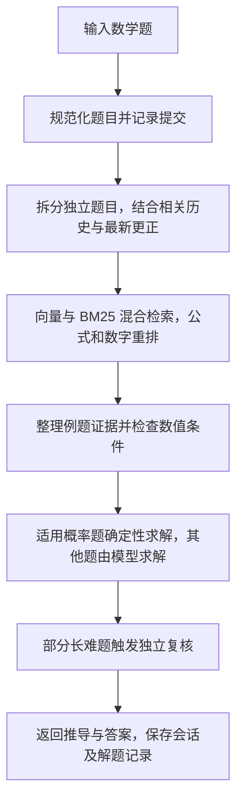
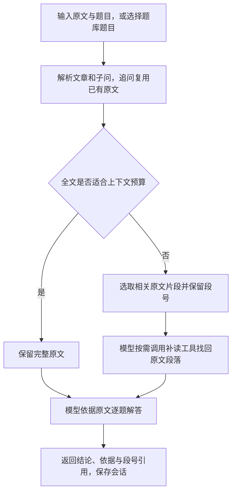

# 数学、语文与英语解题助手

基于 Agent + Harness 的初三学习助手，支持数学检索解题、语文阅读理解和英语选择题，前端使用 Vue，后端使用 TypeScript。

代码阅读与公共层说明见 [架构与恢复策略](ARCHITECTURE.md)。

英语代码位于 `src/modules/english/`，`EnglishAgent` 直接实现通用 `AgentWorkflow`，`EnglishHarness` 通过公共 `PassageHarness` 实现 `HarnessRunner`，由公共层组合基础 `AgentHarness`。它不继承或导入语文、数学的 agent、harness、题库或任务定义。仅使用基础工具声明、上下文预算、重试、取消和结果处理扩展。英语失败、缺少原文、题库不可用或题型不支持时，不会转到其他学科。自动路由识别 `[英语]`、`[英语题:题库ID]`、`[Passage]` / `[Questions]`；也可用 `SCHOOL_SUBJECT=english` 固定英语。

混合学科会话先按学科选择原始历史，语文和英语追问分别只复用各自的原文和对话；其他学科的原文、助手结论不会进入其上下文。共享会话仍保留完整存储，不做破坏性删改。

英语支持阅读、语法单选、完形选择，拒绝作文和听力输入。`ENGLISH_WORKFLOW=grounded` 为默认流程：原文完整时，先获得一份批量解候选，再通过基础 `delegate` 为每题创建隔离的 `english_question_solver`。逐题工作器只接收原文、当前题和当前要求，不接收批量候选、父历史、其他题的答案、题库标签或工具权限；两路候选一致时收敛，分歧时仅把本题的候选选项交给隔离工作器回读原文裁决。所有步骤仍使用 GLM-4.5-Air，不声明独立语义核验通过。语法和完形保持同组求解，避免破坏跨空依赖。工作器不递归、每轮最多32次委派，受通用超时和取消策略约束；工作器失败时由英语父流程有界补答剩余题目，裁决失败则保留逐题候选并记录事件。`ENGLISH_WORKFLOW=direct` 保留单次批量解题基线供对比。

Harness 使用基础 `resultProcessors` 检查题号覆盖、明确的单选结论和冲突；只合并完全一致的重复结论，遗漏或冲突最多重答一次，仍不合法则返回明确不可用说明。该阶段不读取参考答案，也不把格式检查称为语义核验。英语独立语义复核仍未实现，能力接口保持 `review: not_configured`，不会调用数学/语文的复核模型。英语通过独立的 `ENGLISH_THINKING=disabled` 使用本轮验证配置，不受数学/语文 `GLM_THINKING` 设置影响；可显式设为 `enabled` 做对比实验。

裁剪后可用 `english_lookup` 回查原文相邻段落，保留否定、指代和空格编号；原文不完整时沿用英语工具循环，不向缺少原文的工作器分发任务。`full/summary/extractive/hybrid/adaptive` 是英语自己定义的上下文策略。运行时不做带答案的 bank 检索，不按题目ID命中参考答案直接返回；题库ID仅用于取用户指定题目的无答案材料，`authored-bank.ts` 仅参与离线构建练习与评测数据。

```powershell
npm run english:download
npm run english:prepare
# 设置 LLM_API_KEY 后，GLM-4.5-Air 按整篇文章批量解题、逐题评分；不调用复核模型。
npm run eval:english -- --out data/english-experiment --split all --variants adaptive --limit 500 --concurrency 3 --workflow grounded
# 首次执行可冻结额外100题纯阅读留出集；整篇排除原500题，输出不覆盖。
npm run english:holdout
npm run eval:english -- --out data/english-holdout-experiment --corpus evals/english/fresh-holdout.json --split test --workflow grounded
```

生成库为 **500 道选择题**：300 阅读、100 语法、100 完形，知识/开发/测试为 300/100/100，整篇文章和原创模板族不会跨集合。公开阅读题来自 [RACE-M](https://huggingface.co/datasets/ehovy/race)，它覆盖整个初中阶段，不能宣称全部是初三官方真题；语法与完形为原创初三复习题。下载保留原始数据和 SHA256；RACE 的非商业研究条件、来源、原始集合和数据局限记录在生成文件中。来源可能有错误，公开语料也可能已进入模型预训练。

英语实验按文章调度，`grounded` 阅读逐题隔离；父任务和子任务的全部模型调用、尝试与 token 都计入用量，延迟按文章任务统计，正确率按题统计。答案只进入判分器，不进入解题、工具或摘要提示。缺失、冲突或失败答案都计为错误，请求失败不会从分母移除。报告给出按题型/集合的准确率及95% Wilson区间；`--split all` 的全量结果含知识库与开发题，应单独查看 test 指标。新增纯阅读留出集只用于评测，不加入运行时题库。

初次 500 题 GLM-4.5-Air 实验保存在 `data/english-experiment-glm45air-500-v1/`：118 个文章请求，0 个最终失败，正常完成调用 118 次、尝试 119 次。修正明确答案在句尾或加粗时的格式识别后，原始回答本地重判为 467/500（93.4%），留出 test 为 86/100；阅读 267/300，语法与完形各 100/100。请求延迟 p50 4.47 秒、p95 7.38 秒。`comparison.json` 保留最初的严格换行判分，`comparison-format-v2.json` / `.md` 保留重判及判分源码哈希，原始回答和参考答案均未改写。可用 `npm run english:rescore -- EXISTING_EXPERIMENT_DIRECTORY` 复现本地格式重判（输出文件不覆盖）。这是公开初中语料和原创复习题的结果，不能当作私有初三真题泛化准确率。

本轮优化后完整回归为 **484/500（96.8%）**，原测试集为 **97/100**，阅读部分为 **285/300（95%）**；另冻结的未使用纯阅读确认集为 **95/100**。两轮均为0次最终请求失败，全部步骤使用GLM-4.5-Air，未增加运行时带答案的bank检索。完整结果、数据隔离、成本和复现入口见 [英语优化实测报告](ENGLISH_EVALUATION.md)。

## 依赖

- 运行环境：Node.js 24.12+（24.x）、npm、PowerShell 7。
- 后端：Express 5、LangChain、MCP SDK、AJV、js-tiktoken。
- 前端：Vue 3、Vite、KaTeX。
- 模型服务：主解题使用 GLM-4.5-Air，独立核验使用 GLM-4.7；数学检索使用 GLM embedding-3。

npm 依赖通过下面的 `npm ci` 安装；模型服务需要可用的 API Key。

## 子 agent 与答案核验

基础 `AgentRuntime` 提供 `agents` 和 `delegate({ agent, input, context? })`，通过 `HarnessOptions.subAgents` 注册有名字的子 agent。每个定义指定模型、工作流、指令和工具；父任务的历史、工具和权限不会自动传给子任务。子 agent 默认不能继续委派，需在定义的 `delegates` 中明确授权。

新增其他多智能体场景时，注册新的定义并在工作流中调用即可：

```ts
const subAgents = [{
    name: "researcher", description: "核对指定材料", model: researchModel,
    workflow: new SingleTurnAgent(), tools: [],
    instructions: { system: "依据提供的材料核对事实。", final: "返回核对结果。" },
}];
// 将 subAgents 传给 AgentHarness 的 options；工作流通过 runtime 委派。
const result = await runtime.delegate({ agent: "researcher", input: material });
```

`HarnessOptions.delegation` 控制整轮共享的调用次数、嵌套深度、同时运行数量、单次超时和输出长度。子任务仍经过基础 harness 的上下文预算、工具策略、恢复和取消机制；子任务默认不继承父任务的备用模型或结果处理器。追踪通过 `agent.subagent.*` 事件关联任务，调用统计包含子任务。

`HarnessOptions.resultProcessors` 是工作流返回后的通用处理阶段。数学和语文使用 `AnswerReview`：主模型生成候选答案 → GLM-4.7 独立返回结构化核验报告 → 发现确定错误时由主模型修正 → 再核验修正版。程序直接计算得到的答案也经过该阶段。语文核验使用完整原文和实际问题，不读取题库参考答案；数学核验保留用户条件更正及支持的程序计算结果。

`ANSWER_REVIEW_ENABLED` 控制启用；GLM 开发/生产配置默认启用，测试和旧通用模型配置默认关闭。`ANSWER_REVIEW_MODEL` 默认为 `glm-4.7`，`ANSWER_REVIEW_TIMEOUT_MS` 默认为 120000，`ANSWER_REVIEW_MAX_REVISIONS` 默认为 1。同一地址复用 `LLM_API_KEY`；不同地址必须显式提供 `ANSWER_REVIEW_API_KEY`。凭据只从启动进程环境读取，`.env` 文件中的凭据会被忽略。

只有有效的通过报告才能发布候选答案。核验不确定、错误仍未修复、服务不可用或报告格式无效时，返回无法确认的提示并记录对应状态；用户取消会终止整轮。模型核验通过不等于数学证明或可信题库审核，答案不会自动进入可信题库。

运行 `npm test` 覆盖离线边界和本地 HTTP 协议；设置凭据后运行 `npm run smoke:review:live`，会用已有数学、语文评测题做真实模型联调，结果写入忽略版本控制的 `data/review-smoke/`。这是少量样例检查，不代表整体准确率评测。

## 启动

### 后端

在项目目录（包含 `backend` 和 `frontend`）打开 PowerShell：

```powershell
cd backend
npm ci
if (-not (Test-Path -LiteralPath .env)) {
    Copy-Item -LiteralPath .env.example -Destination .env
}

$env:LLM_API_KEY = Read-Host "GLM API Key" -MaskInput
$env:LLM_BASE_URL = "https://open.bigmodel.cn/api/paas/v4"
$env:LLM_MODEL = "glm-4.5-air"
$env:ANSWER_REVIEW_ENABLED = "true"
$env:ANSWER_REVIEW_MODEL = "glm-4.7"
$env:MATH_EMBEDDING_BASE_URL = "https://open.bigmodel.cn/api/paas/v4"
$env:SCHOOL_SUBJECT = "auto"
$env:MATH_AGENT_VARIANT = "adaptive"
$env:READING_AGENT_VARIANT = "adaptive"
$env:PORT = "8080"
$env:FRONTEND_ORIGIN = "http://localhost:5173"
```

首次使用数学解题时，在同一终端生成题库并建立索引（索引构建会调用 embedding 服务）：

```powershell
npm run math:expand
npm run math:index
```

已有匹配的题库和索引可跳过；题库或 embedding 配置改变后需重新建索引。`evals/` 和 `data/` 不随仓库分发。API Key 只从终端环境读取，不写入 `.env`；模型与 embedding 使用不同服务地址时，另设 `EMBEDDING_API_KEY`。

语文支持直接粘贴以 `[原文]`、`[题目]` 分隔的阅读材料；如需使用内置题库，先下载并整理公开阅读题：

```powershell
npm run chinese:download -- 100
npm run chinese:prepare
```

最后启动后端：

```powershell
npm run dev
```

### 前端

在项目目录另开终端：

```powershell
cd frontend
npm ci
npm run dev
```

打开 [http://localhost:5173](http://localhost:5173)，前端默认将请求转发到后端 `8080` 端口。

## 解题流程

`SCHOOL_SUBJECT=auto` 根据当前输入及会话历史选择学科。以下为 `adaptive` 模式；Agent 负责解题步骤，Harness 负责上下文、工具执行、预算与重试。

### 数学

先检索相似例题并检查条件，再依据当前题目求解；长对话结合相关历史和用户更正，多道独立题分别处理。



### 语文

以原文为依据回答阅读题。全文能放入上下文时直接保留；超出预算则选取相关原文，并允许按段号补读。


