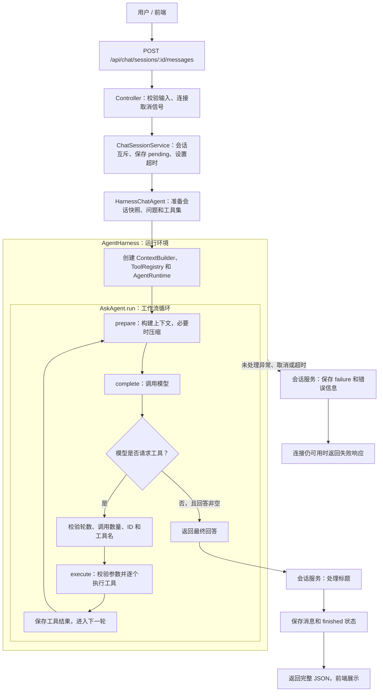

# Ask Agent 后端

基于 **Node.js + TypeScript + Express 5** 的问答 Agent 服务。支持会话管理、历史记忆检索、工作区只读工具和本地 JSON 持久化。

AskAgent 用 TypeScript 实现多轮工具调用工作流；Harness 提供上下文构建、工具执行、超时取消与日志；LangChain 负责接入 OpenAI 兼容模型。模型按需选择工具，也可以直接回答。

## 快速运行

准备 Node.js 22.18+ 或 24.x、npm，以及支持工具调用的 OpenAI 兼容模型服务。以下命令使用 PowerShell。

### 1. 安装依赖

从项目根目录进入后端：

```powershell
cd backend
npm install
```

后续命令均在 `backend` 目录执行。

### 2. 配置并启动开发服务

```powershell
$env:PORT = "8080"
$env:FRONTEND_ORIGIN = "http://localhost:3000"
$env:LLM_BASE_URL = "https://api.deepseek.com"
$env:LLM_MODEL = "deepseek-flash"
$env:LLM_API_KEY = Read-Host "输入模型 API Key"
npm run dev
```

这里的模型地址和名称与当前代码默认值一致；使用其他服务时，改为该服务的兼容接口地址和你有权限使用的模型名。开发模式会监听源码变化并重启，按 `Ctrl+C` 停止。

**`LLM_API_KEY` 只从启动终端的环境变量读取，写入 `.env` 不会加载。** 上述变量只影响当前 PowerShell 会话；新开终端需重新设置。修改配置后重启后端。

### 3. 检查服务

保持服务运行，在另一个 PowerShell 中执行：

```powershell
Invoke-RestMethod http://localhost:8080/api/health
```

应返回 `httpStatusCode: 200`。这只检查 HTTP 服务；验证模型与工具调用可使用下文的真实模型冒烟命令。

### 编译后运行

在已配置环境变量的终端执行：

```powershell
npm run build
npm start
```

构建产物位于 `dist/`，启动入口为 `dist/server.js`。

## 常用配置

后端自动读取 `backend/.env` 中支持的非敏感配置，**终端环境变量优先于 `.env`，最后使用代码默认值**。可参考 [.env.example](.env.example) 编辑配置；以下是代码默认值，并非对本机 `.env` 的描述。

| 变量 | 默认值 | 说明 |
| --- | --- | --- |
| `PORT` | `8080` | 后端监听端口 |
| `FRONTEND_ORIGIN` | `http://localhost:3000` | 允许的前端来源，需与实际前端地址一致 |
| `LLM_BASE_URL` | `https://api.deepseek.com` | OpenAI 兼容模型接口地址 |
| `LLM_MODEL` | `deepseek-flash` | 模型名称 |
| `LLM_API_KEY` | 无 | 模型凭据，仅从环境变量读取 |
| `LLM_TIMEOUT_MS` | `120000` | 模型请求及会话执行的超时配置，单位毫秒 |
| `SESSION_DATA_DIR` | `backend/data/sessions` | 会话 JSON 存储目录 |
| `AGENT_WORKSPACE_ENABLED` | `true` | 是否开放工作区只读工具 |
| `AGENT_WORKSPACE_ROOT` | `.` | 相对 backend 解析；`..` 表示项目根目录 |
| `AGENT_MAX_TOOL_STEPS` | `4` | 最多工具调用轮数，之后还有一轮最终回答 |
| `AGENT_MAX_CALLS_PER_STEP` | `4` | 每轮最多工具调用次数，逐个执行 |
| `AGENT_TOOL_TIMEOUT_MS` | `15000` | 单个工具的执行超时 |
| `LLM_MAX_INPUT_TOKENS` | `32768` | 上下文输入预算 |

`.env.example` 中的 `FRONTEND_ORIGIN` 为 `http://localhost:5173`，请按实际前端端口调整。前端代理的目标端口也需与 `PORT` 一致。

默认无需数据库或 Elasticsearch 即可启动：会话保存在本地 JSON 文件，记忆使用本地检索。配置 `ELASTICSEARCH_URL` 后可使用 Elasticsearch；配置 embedding 服务可启用向量混合检索。相关配置见示例文件，凭据通过终端环境变量传入。当前 JSON 仓储适用于单后端进程。

## 线框流程图

下图对应一次发送消息的流程。**Harness 包住整个 Agent 执行循环**：AskAgent 决定循环和结束，Harness 实现 `prepare / complete / execute`。



- 普通轮次向模型提供工具定义，由模型决定是否检索；不会自动遍历执行所有工具。
- 默认最多 4 轮工具调用，随后禁用工具并要求最终回答；模型也可以提前结束。
- 普通工具错误会转成工具结果供模型处理；无法继续的运行错误由会话服务记录失败。
- 成功后保存本轮用户消息和回答；失败不追加本轮消息。响应是完整 JSON。

## 接口

| 方法 | 路径 | 用途 / 请求体 |
| --- | --- | --- |
| GET | `/api/health` | 健康检查 |
| POST | `/api/chat/sessions` | 创建会话：`{ "title": "新对话" }` |
| GET | `/api/chat/sessions` | 获取会话列表及历史 |
| GET | `/api/chat/sessions/:id` | 获取指定会话 |
| POST | `/api/chat/sessions/:id/messages` | 发送问题：`{ "content": "请解释项目结构" }` |

创建会话返回 201，消息执行成功返回 200；模型执行失败返回 400，并携带会话的 `failure` 状态和错误信息。会话不存在返回 404，同一会话并发发送返回 409，服务器内部故障返回 500。客户端已断开时不会继续发送响应。

## 核心代码与工具扩展

| 文件 | 职责 |
| --- | --- |
| [bootstrap/chat-agent.ts](src/bootstrap/chat-agent.ts) | 组装工作流、Harness、提示词和工具集 |
| [ask-agent.ts](src/modules/agent/ask-agent.ts) | 工作流循环与结束条件 |
| [agent-harness.ts](src/modules/harness/agent-harness.ts) | 为工作流提供上下文、模型和工具执行接口 |
| [context-builder.ts](src/modules/harness/context-builder.ts) | 上下文构建与压缩触发 |
| [define-tool.ts](src/modules/harness/define-tool.ts) | 统一工具封装，生成参数 schema 与校验 |
| [tool-registry.ts](src/modules/harness/tool-registry.ts) | 注册、执行、超时、错误处理与输出截断 |
| [workspace-tools.ts](src/modules/harness/workspace-tools.ts) | 列目录、读文件、搜索代码 |
| [memory-tools.ts](src/modules/chat/service/memory-tools.ts) | 当前会话与其他会话的记忆检索 |
| [langchain-chat-model.ts](src/infrastructure/llm/langchain-chat-model.ts) | LangChain 模型协议适配 |
| [chat-session.service.ts](src/modules/chat/service/chat-session.service.ts) | 会话状态、消息保存与标题处理 |

新增工具使用 `defineReadOnlyTool()`，在对应工具工厂中返回，再由装配层接入。完整示例见 [工具扩展指南](TOOL_AUTHORING.md)。

## 测试与验证

```powershell
# 工具封装单元测试
node --import tsx --test tests/define-tool.test.ts

# 后端全量测试和类型检查
npm test
npm run typecheck

# 本地 HTTP 冒烟：搜索 → 读文件 → 回答 → 保存 → 重启恢复
npm run smoke:agent
```

上述自动化测试使用本地服务或测试替身，无需真实模型 Key。要验证实际供应商，在已配置模型环境变量的终端执行：

```powershell
npm run smoke:agent -- --live
```

`--live` 会发起真实模型请求；失败不会切换到本地模拟服务。
# MCP 工具接入

后端支持官方 MCP stdio、Streamable HTTP 和 SSE 传输。已有 `defineReadOnlyTool` 工具保持兼容，MCP 工具在每次回答开始时动态发现，并使用服务器命名空间避免重名。服务配置独立持久化，禁用会关闭连接并拦截已经获取的工具句柄。

完整教程：[MCP 接入与自建服务](docs/MCP_GUIDE.md)。恢复策略：[重试与备用模型](docs/HARNESS_RECOVERY.md)。运行诊断：[每个问题的执行记录](docs/AGENT_OBSERVABILITY.md)。

管理接口：`GET /api/mcp/servers`、`POST /api/mcp/servers/import`、`PATCH /api/mcp/servers/:id`、`POST /api/mcp/servers/:id/test`。导入接受单个配置或 `{ "mcpServers": { "服务id": { ... } } }`。默认禁用，只开放标记 `readOnlyHint: true` 的工具；开启 `allowMutations` 后可提供其他工具。

管理接口默认只接受本机连接与配置的前端 Origin。远程部署在进程环境中设置 `MCP_ADMIN_TOKEN`，请求带 `Authorization: Bearer ...`。MCP 凭据可用 `${ENV_VAR}` 在后端解析，管理响应不会返回配置中的凭据。方案见 [MCP_HARNESS_PLAN.md](docs/MCP_HARNESS_PLAN.md)。
