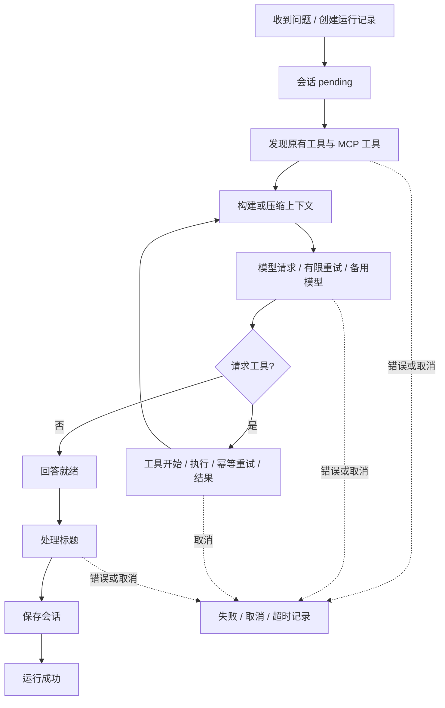

# 每个问题的执行记录

默认每次经聊天服务处理的问题都有独立的 `runId`，包括失败的问题。运行记录与用户可见聊天历史分开保存，历史中仍只有用户消息与最终回答。客户端断网、取消或模型失败导致未保存消息时，仍可通过运行记录查到该问题的执行过程。

前端会话下方的 **执行流程** 默认收起。展开后可以查看每个问题的状态、耗时、事件详情、参数和结果摘要，以及导出 JSON。新记录由新到旧排列；每次读取 20 条，支持加载更早记录。处理中的问题在面板展开时每 2 秒刷新，收起或离开页面停止刷新。

## 关联关系

- `sessionId`：聊天会话。
- `requestId`：发送问题时的 HTTP 请求，与已有结构化日志关联。
- `runId`：一个问题的一次完整运行。重试同一个问题会创建新运行。
- `userMessageId` / `assistantMessageId`：成功保存的问答消息；失败运行不创建虚构的回答消息。
- `modelCallId`：一次逻辑模型请求，尝试次数与备用模型共享这个 ID。
- `callId`：模型发出的工具调用 ID；开始、重试与结束使用同一个 ID。

事件按递增 `sequence` 排序，同时记录 ISO 时间、相对运行开始的毫秒数和操作耗时。流程大致为：



工具业务错误通常作为 tool 结果交给模型继续处理，未必使整个运行失败。MCP 连接失败只记录该服务不可用，原有工具仍继续提供。

当 MCP 工具目录超过上下文预算时，记录 `agent.tools.selected`，包含纳入工具数量、省略数量和 MCP token 预算。原有自定义工具优先保留。

## 内容与权限

记录包括模型请求次数、工具名与来源、参数、截断后的结果摘要、上下文 token 估计、压缩、重试、回退、标题处理和会话保存事件。保存公开的最终回答摘要，**不保存隐藏推理、完整模型提示词或完整历史副本**。token 数量来自当前 TokenBudget 的估计，不等同于供应商账单用量。

密码、密钥、Authorization、Cookie、env/headers 等敏感字段与常见 Bearer/Basic/URL 凭据会被替换；已知模型、管理及敏感进程环境凭据也会替换。字段值、嵌套深度和总大小有限制。脱敏针对字段与已知模式，无法自动识别所有业务隐私，工具作者仍应只返回任务需要的数据。

管理读取接口与 MCP Hub 共用 `MCP_ADMIN_TOKEN`，同样限制浏览器 Origin；未设置令牌时仅允许本机访问。前端“管理认证”可填写令牌，只存于当前页面内存，不写入 localStorage。运行摘要不会随公开聊天列表返回。

生产环境必须配置管理员令牌，否则管理读取接口返回 503；这不阻止聊天运行和记录保存。

## 存储、恢复和限制

默认路径是会话目录同级的 `<会话目录名>-runs`，例如 `data/sessions-runs/<sessionId>/<runId>.json`。可以通过 `AGENT_RUN_DATA_DIR` 修改，建议使用独立持久化卷；不要放到会话 JSON 目录中。工作区读取工具会排除记录目录。

运行开始先保存 pending 记录，事件变更通过串行原子替换更新；结束后等待最后一份记录写入。读取未被当前进程拥有的 pending 记录时，标记为 `interrupted`，以说明后端重启中断。一个后端进程拥有目录，不支持多个进程同时写同一目录。

默认每个运行最多 512 个事件；超出上限时统计省略数并保留最终状态。可设置 `AGENT_TRACE_MAX_EVENTS=2..1024`。记录写入失败会输出 `trace.start_failed` 或 `trace.persist_failed`，回答继续运行；这时该记录可能不完整或无法保存。设置 `AGENT_TRACE_ENABLED=false` 关闭持久化，读取接口返回明确的 503。

记录不会自动删除。如需控制存储容量，请手动归档或清理明确的记录文件。本项目遵守禁止批量删除的操作约束。

## HTTP API

`GET /api/observability/sessions/:sessionId/runs?limit=20&before=<runId>` 返回：

```json
{ "data": { "runs": [{ "id": "...", "status": "success", "question": "...", "eventCount": 20 }], "nextCursor": "..." } }
```

`GET /api/observability/sessions/:sessionId/runs/:runId` 返回完整的脱敏运行记录与事件。分页最多 50 条；未知运行返回 404，无效参数返回 400。令牌开启时都需要 `Authorization: Bearer <token>`。

泛用 Harness 可以通过 `HarnessInput.onEvent(name, fields)` 接入自己的事件接收器；聊天适配器通过可选 `ChatAgentRunContext` 把发现工具的事件与 harness 事件关联到同一个运行。已有自定义 workflow 和工具接口继续兼容。

## 参考与验证

设计参考本工作区 VS Code Copilot 源码中的请求捕获关联机制、工具开始/结束配对与按请求读取日志：

- `vscode/extensions/copilot/src/platform/requestLogger/node/requestLogger.ts`：请求关联上下文。
- `vscode/extensions/copilot/src/platform/requestLogger/common/requestLogger.ts`：按 ID 查询请求与工具日志。
- `vscode/src/vs/platform/agentHost/node/copilot/mapSessionEvents.ts`：tool.execution_start/complete 映射。

这里只借鉴事件分层与关联方式，未复制 VS Code 的运行时或界面。测试覆盖真实 MCP 回答记录、事件顺序、失败与取消、迟到结果、并发隔离、重启恢复、分页、脱敏、保存故障、管理员权限和会话切换。
