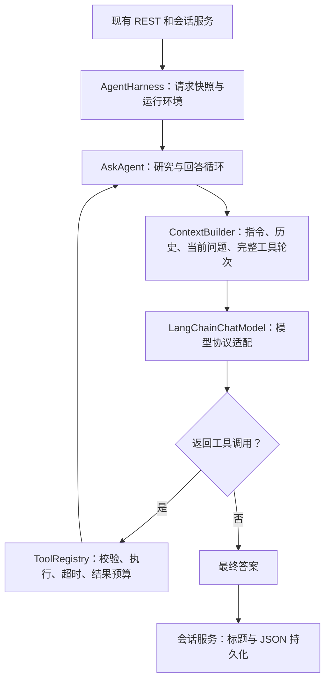

# Ask Agent 与 Harness

## 架构与本地 Copilot 源码参考

这里的 Harness 指 Ask Agent 的运行环境，参考的是本地 `vscode/extensions/copilot` 的实现结构，而不是测试 harness 或编辑器的 harness 切换 UI。未复制 VS Code 服务容器、编辑器 API 或其完整提示词，未引入新的编排框架。

| 本地参考源码 | 提取的设计 | 本项目实现 |
| --- | --- | --- |
| [askAgentProvider.ts](../../vscode/extensions/copilot/src/extension/agents/vscode-node/askAgentProvider.ts) | Ask 只读；理解、研究、澄清、回答 | `agent/prompt.ts`，澄清通过普通回复等待下一条用户消息 |
| [askAgentIntent.ts](../../vscode/extensions/copilot/src/extension/intents/node/askAgentIntent.ts) | 为 Ask 选择可用检索工具，配置调用上限 | `harness/agent-harness.ts`，请求级工具集 |
| [toolCallingLoop.ts](../../vscode/extensions/copilot/src/extension/intents/node/toolCallingLoop.ts) | 逐轮构建 prompt，模型决策，记录完整调用轮次 | `agent/ask-agent.ts`、`agent/contracts.ts` |
| [toolsRegistry.ts](../../vscode/extensions/copilot/src/extension/tools/common/toolsRegistry.ts)、[toolsService.ts](../../vscode/extensions/copilot/src/extension/tools/common/toolsService.ts) | 分离工具定义、输入验证和调用 | `harness/tool-registry.ts`，定义与执行器一同注册 |
| [conversationHistory.tsx](../../vscode/extensions/copilot/src/extension/prompts/node/panel/conversationHistory.tsx) | 历史保留消息角色，按预算组装 | `harness/context-builder.ts`，完整轮次压缩 |

`AskAgent` 只依赖 `AgentRuntime` 接口，不依赖 Express、文件系统、仓储或 LangChain。`AgentHarness` 提供上下文、模型和工具执行能力；`ChatSessionService` 仅负责请求互斥、状态和结果落盘，不再有直接调用模型的备用分支。

工作流：创建请求快照 → 构建上下文 → 模型决定直接回答或选工具 → 校验完整批次 → 顺序执行 → 将结果作为 tool 消息反馈 → 下一轮。最多执行 `AGENT_MAX_TOOL_STEPS` 轮工具，随后额外进行一次不提供工具的总结调用。空答案、无效协议、重复 ID、未启用工具或超过调用上限会使整轮聊天失败；合法工具的参数错误、访问拒绝、执行失败或超时成为可供模型修正的工具结果。取消会直接终止整个运行。

不自动重试模型 API。模型根据工具错误改用正确参数属于新的决策轮次，仍计入上限。每个成功轮次只保存用户问题和最终答案；模型的工具调用文本不是最终答案。模型统一实现 `agent/model.ts` 中的必需 `turn(messages, tools, signal, maxOutputTokens)`，摘要和标题用相同协议传入空工具列表。旧 Harness 别名、文本模型回退、独立 reply 接口及外部结果回调均已删除。

## 运行与配置

现有 `npm install`、`npm run dev` 入口不变。`.env` 只加载非密钥配置，API key 仍从启动终端继承。

| 配置 | 默认值 | 含义 |
| --- | --- | --- |
| LLM_MAX_INPUT_TOKENS | 32768 | 模型允许的最大**输入**，请按实际供应商设置；如果只知道总窗口，应先扣除输出预算（回答上限 4096） |
| CONTEXT_CHUNK_TOKENS | 512 | 可配置 128–2048，建议比较 512/1024 |
| CONTEXT_OVERLAP_RATIO | 0.15 | 相邻块重叠；中间块前后合计不超过 30% |
| CONTEXT_COMPRESSION_TRIGGER | 0.65 | 触发区间 0.60–0.70 |
| CONTEXT_COMPRESSION_TARGET | 0.08 | 记忆摘要目标为输入上限的 5%–10%，不包括当前问题和固定指令 |
| CONTEXT_TOKENIZER | cl100k_base | 也支持 o200k_base；供应商不同需选择近似 tokenizer 并提高安全系数 |
| CONTEXT_TOKEN_SAFETY_FACTOR | 1.2 | 1–3；不是供应商真实 token 用量保证 |
| AGENT_MAX_TOOL_STEPS | 4 | 最多四轮工具调用，每轮最多四个工具，最后一次模型调用不提供工具 |
| AGENT_MAX_CALLS_PER_STEP | 4 | 每轮最多工具数，范围 1–8；先校验整批工具名和 ID 再执行 |
| AGENT_TOOL_TIMEOUT_MS | 15000 | 单次工具执行期限；整个请求仍受 LLM_TIMEOUT_MS 约束 |
| AGENT_TOOL_OUTPUT_TOKENS | 2048 | 单次工具输出预算，超出时带明确截断标记；之后仍须满足总上下文预算 |
| AGENT_WORKSPACE_ENABLED | true | false 时不向模型暴露任何文件工具 |
| AGENT_WORKSPACE_ROOT | . | 相对 backend 目录解析，不依赖启动时 cwd；设为 .. 可包含 frontend、vscode |
| ELASTICSEARCH_URL | 未配置 | 未配置时使用本地 BM25；配置后失败会明确报错，不自动降级 |
| ELASTICSEARCH_INDEX | chat-memory-v1 | 每个仓库/独立用户数据域使用独立索引 |
| EMBEDDING_BASE_URL | 未配置 | 兼容 `/embeddings` 的服务根路径，例如 `http://host:port/v1` |
| EMBEDDING_MODEL | 未配置 | 必须和 base URL 一起设置；不要假定聊天供应商提供 embedding |
| EMBEDDING_DIMENSIONS | 1536 | 必须与 embedding 实际维度匹配 |

密钥环境变量：`LLM_API_KEY`、`EMBEDDING_API_KEY`、`ELASTICSEARCH_API_KEY`。后两者按服务认证要求设置。只配置 Elasticsearch 时运行 ES BM25；同时配置 embedding 才是混合向量检索。

建议 Elasticsearch 8.19 或兼容的 9.x 服务。使用 `compose.memory.yml` 可启动单机开发实例：`docker compose -f compose.memory.yml up -d`，然后设置 `ELASTICSEARCH_URL=http://localhost:9200`。此 compose 仅绑定本机并关闭认证，不能用于公开部署。未连接真实服务时，HTTP 协议测试只能证明客户端请求/处理行为，不能证明真实索引质量。

更改 embedding 模型、维度、tokenizer、分块大小时，请使用新的索引名，避免旧映射或分块混用。文档按内容寻址，`_mget` 避免重复 embedding；查询同时过滤本次快照中的文档 ID，旧标题和旧分块不能进入结果。旧派生记录保留，后续索引维护由使用者手动安排。索引是可重建的派生数据，JSON 会话才是历史事实来源。项目目前是单用户、单后端进程原型；共享范围是此 repository 的会话，不具备多租户身份隔离。接入多用户前必须按用户隔离 repository 和索引，不能共用全局候选集合。

## 工具接口与数据流

核心模块只有 `src/modules/agent/`（工作流与模型协议）和 `src/modules/harness/`（运行环境），都不依赖 Express。token、摘要、标题和记忆能力位于 `harness/context/`；旧 context 模块与旧工具接口已删除。所有对模型暴露的工具仅通过 `RegisteredTool` 注册：

- `memory-tools.ts`：直接注册当前/共享会话检索，结果带 session/chunk 来源，不再包裹旧工具实例。
- `SessionTitleGenerator`：前五个成功 user/assistant 轮次更新标题；第六轮及之后直接返回已存标题。规则：中文 10–15 个汉字，英文 5–10 个单词。非法输出最多纠正一次；持续失败保留合规旧标题或使用合规占位标题，并记录日志，不伪造模型成功。
- `ContextCompressor`：分批 map/reduce 调模型摘要，保留偏好、决定、约束、未解决问题和来源；每个摘要请求也受输入预算限制，输出硬限制并再次计数。压缩失败明确中止本次生成。
- `SharedMemoryRetriever`：排除当前会话，选按更新时间排序的最近十个非空会话；先检索标题，最多选三个匹配会话，只携带其压缩内容。无匹配不注入。历史数据与工具结果标记为不可信数据。
- `AgentHarness`：固定当前会话与最近十个其他会话的快照，组合工作流、上下文和工具。工具只能搜索当前请求快照内的会话，模型无法提供任意会话 ID。取消信号覆盖模型、压缩、检索和工具；即使注入的 provider 忽略信号，调用者也会按时退出，迟到结果不能保存。

上下文按“系统指令 → 历史或历史摘要 → 当前问题 → 完整工具轮次”组装，保留 user/assistant 角色。原始历史全部参与预算；不以 top-k 代替完整会话。每轮预算包含系统指令、消息封装、工具 schema 和预留开销。当前问题不截断、只出现一次。超限先摘要旧内容，尽可能原样保留最新完整工具轮次；若该轮也放不下，则整轮一起摘要，不留下孤立 tool 消息。不修改持久化历史，已压缩轮次不会被重复拼入下一次摘要。

记忆索引和检索只在模型选择记忆工具时触发。简单问答不触发 embedding；外部记忆服务不可用时，Agent 可看到安全的工具错误并说明证据不足。摘要和标题是 Harness 内部能力，不作为可由模型任意调用的工具暴露。

模型可用工具：

| 工具 | 输入 | 结果 |
| --- | --- | --- |
| search_session_memory | query | 当前会话的相关片段与 session/chunk 标识 |
| search_shared_memory | query | 最近十个其他会话中最多三个标题匹配会话的摘要 |
| list_directory | path | 至多 200 个可读文件或目录；超限标记 |
| search_workspace | path, query | 大小写不敏感的字面文本搜索，返回相对路径、行号、片段 |
| read_file | path, startLine, endLine | 每次最多 200 行，带行号和总行数 |

文件工具仅允许配置目录内的文本源码，不提供写文件或终端命令。拒绝绝对路径、`..`、Windows ADS、符号链接/junction、隐藏文件、常见凭据文件、依赖目录、构建产物和会话数据。额外排除实际 `SESSION_DATA_DIR`，路径比较先规范化 Windows 长/短路径。单文件最大 1 MiB；搜索上限为 2,000 个文件、10,000 个目录项、约 8 MiB 文本及 50 个命中。结果超过上限会注明 truncated，模型应缩小路径或查询。此功能按单用户受信任源码工作区设计，不是隔离不可信本机进程的操作系统沙箱，也不是源码中的秘密扫描器。

扩展工具时实现 `RegisteredTool` 的 definition、validate、execute，并由 Harness 注册。只有注册的只读工具会进入 schema；模型调用的名称必须属于本轮暴露的集合。新增工具应同时增加输入错误、取消、访问边界和输出预算测试。工具执行异常仅返回固定错误码，不能向模型泄漏原始凭据或服务器路径。

`.json` 中的 `messages` 始终保存完整成功往返；模型摘要、工具结果和 system 消息不写入聊天历史。前端通过原有接口接收新的 title 与原始 messages。失败重试不增加成功轮次，重启后按历史计算轮次，冻结不会重置。

日志 `agent.started/phase/context/tool/completed/failed` 记录运行阶段、工具状态、估算 token、耗时、调用数，携带 sessionId/requestId；`context.compressed` 记录压缩前后估算；`context.title_failed` 记录标题失败。运行日志不记录问题、源码、答案、原始工具错误或密钥。现有前端继续显示 pending/finished/failure，无需理解工具内部协议。

## 验证

`npm test` 覆盖既有会话/记忆行为，以及独立工作流、参数修正、工具超时、拒绝越界/敏感路径/junction、长结果与完整协议压缩、并发隔离、轮次上限、不配合取消的 provider 和迟到结果。`npm run build` 同时检查生产 TypeScript 并构建。前端目录执行 `npm test` 和 `npm run build`。

`npm run smoke:agent` 启动真实后端和本机兼容 HTTP 模型端点，经过真实 LangChain 工具协议，验证搜索 → 读取 → 最终回答 → 标题 → JSON → 后端重启恢复。`npm run smoke:agent -- --live` 使用终端的 LLM_API_KEY、LLM_BASE_URL、LLM_MODEL，创建独立源码夹具和会话目录，验证真实模型能够读取未知源码并回答；未设置 key 会明确退出，不伪造成功。

本次本地验证（2026-10-11）：后端测试、前端测试与构建、本地 HTTP smoke 已通过。真实供应商未验证：运行环境没有 LLM_API_KEY。新增文件工具在 Docker 中只看到容器内文件；如需读取宿主项目，须由部署者将项目只读挂载到容器并把 AGENT_WORKSPACE_ROOT 指向该挂载点。

测试使用确定性模型和本机 HTTP stub，不调用付费 API。摘要语义质量、真实 embedding 召回率以及真实模型工具调用能力仍需配置实际供应商后验证。遵守仓库禁止批量删除规则，测试结束会保留临时目录供人工清理。
